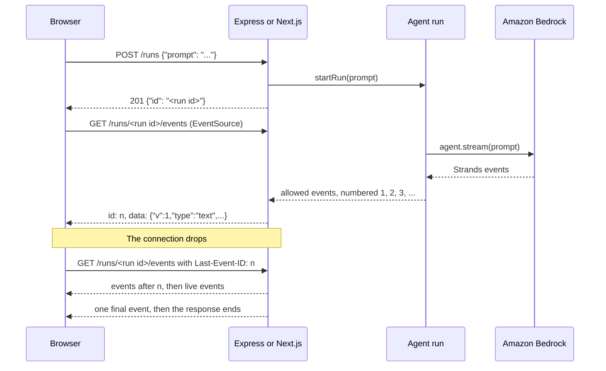

# Stream a Strands agent to the browser with SSE

Show users the agent's answer while the model is still generating it. This sample streams a Strands agent to the browser with server-sent events (SSE), from Express or the Next.js App Router. The browser receives a versioned event schema that never carries reasoning or tool input, every event has an ID the browser can resume from, and every run ends with one authoritative final message.

It is the complete example for the [Stream to the browser with SSE](https://strandsagents.com/docs/user-guide/sdk/streaming/streaming-to-the-browser-guide/) guide.

## Overview

| Information            | Details                                                  |
|------------------------|----------------------------------------------------------|
| **Agent Architecture** | Single-agent                                             |
| **Native Tools**       | None                                                     |
| **Custom Tools**       | `get_weather` (returns canned data, no API key needed)   |
| **MCP Servers**        | None                                                     |
| **Use Case Vertical**  | General-purpose / developer starter                      |
| **Complexity**         | Intermediate                                             |
| **Model Provider**     | Amazon Bedrock                                           |
| **SDK Used**           | Strands Agents TypeScript SDK                            |

### Architecture



Each prompt starts a run: one agent invocation that the server tracks by ID. The run lives apart from any HTTP connection. It maps each Strands event through an allowlist, numbers the events it publishes, and keeps the latest 500 for replay. A browser that reconnects reports the last ID it received and gets everything after it.

### Key Features

- **Versioned public schema**: four event types (`text`, `redact`, `tool`, `final`), each with `v: 1`. An allowlist maps Strands events onto them, so reasoning, tool input, tool results, and citation sources never reach the browser.
- **Resumable streams**: every event has an SSE `id:` line. `EventSource` reconnects with `Last-Event-ID`, and the server replays the events the browser missed.
- **One authoritative final event**: every run ends with exactly one `final` event that carries the full answer, cited text included. Its status says how the run ended: `complete`, `incomplete`, `blocked`, `cancelled`, or `error`.
- **Concurrent tool calls**: each tool call gets its own `callId`, so the page tracks calls that run at the same time, even two calls to the same tool.
- **Guardrail redaction**: when an output guardrail blocks the response, a `redact` event replaces the text on screen. Text streams before the guardrail assesses the whole response, so the user may already have read it.
- **Runs that outlive connections**: a dropped connection only unsubscribes. After 30 seconds with no listener, the run requests cancellation of its agent.
- **Slow clients**: the server drops a connection once 256 KiB of events wait for it. `EventSource` reconnects, and the buffer replays the rest.
- **Long polling fallback** (Express): the same events and IDs, for networks that buffer streaming responses.
- **Two frameworks**: an Express server with a plain HTML page, and a Next.js app with route handlers and a client component.

## Prerequisites

- Node.js **22.9** or later
- AWS credentials in the default credential chain (environment variables, the shared config file, SSO, or an IAM role)
- [Amazon Bedrock model access](https://docs.aws.amazon.com/bedrock/latest/userguide/model-access-modify.html) for Claude Sonnet 4.6 (`global.anthropic.claude-sonnet-4-6`), or for the model you set in `MODEL_ID`

## Setup

Pick one of the two apps. Both stream the same events.

**Express:**

```bash
cd typescript/01-learn/04-streaming/express
npm install
cp .env.example .env   # optional: change the port, model, or AWS Region
```

**Next.js:**

```bash
cd typescript/01-learn/04-streaming/nextjs
npm install
cp .env.example .env.local   # optional: change the model or AWS Region
```

## Usage

**Start the Express server:**

```bash
npm start
```

**Or start the Next.js app:**

```bash
npm run dev
```

For a production build of the Next.js app, run `npm run build` and then `npm start`.

Open `http://localhost:3000` and ask a question, such as "What is the weather in Lisbon?". The answer streams into the page, and the status line shows `Running get_weather` while the tool runs. When the run ends, the final event replaces the streamed text. **Events on the wire** lists every event the browser received.

To see concurrent tool calls, ask about two cities, such as "What is the weather in Lisbon and Porto?". When the model calls the tool for both cities at once, the status line lists both calls until each one finishes.

Try the controls:

- **Stop the run** calls the cancel route. The run ends with a final event with status `cancelled`.
- **Drop the connection** closes the stream and opens a new one two seconds later with `?after=<last id>`. The IDs in the log continue without gaps or repeats.
- **Use long polling** (Express only) reads the same events from the poll route instead of `EventSource`. Set it before you send the prompt, or switch it and then drop the connection.

### From a terminal

```bash
RUN_ID=$(curl -s -X POST localhost:3000/runs -H 'Content-Type: application/json' \
  -d '{"prompt": "What is the weather in Lisbon?"}' \
  | node -p 'JSON.parse(require("fs").readFileSync(0, "utf8")).id')

curl -N "localhost:3000/runs/${RUN_ID}/events"
curl -N -H 'Last-Event-ID: 5' "localhost:3000/runs/${RUN_ID}/events"
```

The first command keeps the run ID in `RUN_ID`. The last one replays the run from event 6. A finished run stays on the server for five minutes. In the Next.js app, the paths are `/api/runs` and `/api/runs/events?id=${RUN_ID}`, quoted the same way.

### Endpoints

| Express                         | Next.js                         | Description                                                                         |
|---------------------------------|---------------------------------|-------------------------------------------------------------------------------------|
| `POST /runs`                    | `POST /api/runs`                | Starts a run with `{ "prompt": string }` and returns `201` with `{ "id" }`          |
| `GET /runs/<id>/events`         | `GET /api/runs/events?id=<id>`  | Streams the run with SSE, after `Last-Event-ID` or `?after=`. `204` after it ends   |
| `GET /runs/<id>/poll?after=<n>` | Not included                    | Returns the events after `n`, waiting up to 25 seconds for a new one                |
| `POST /runs/<id>/cancel`        | `POST /api/runs/cancel?id=<id>` | Cancels the run and returns `202`                                                   |

### Event schema

Each SSE message is an `id:` line and a `data:` line with one JSON event:

```text
id: 8
data: {"id":8,"v":1,"type":"tool","callId":1,"name":"get_weather","status":"started"}
```

| Type     | Fields                                                                                      | Meaning                                                    |
|----------|---------------------------------------------------------------------------------------------|------------------------------------------------------------|
| `text`   | `text`                                                                                      | A piece of the model response, cited text included         |
| `redact` | `text`                                                                                      | A guardrail blocked the response: show `text` instead      |
| `tool`   | `callId`, `name`, `status` (`started`, `succeeded`, `failed`)                               | One tool call, without its input or result                 |
| `final`  | `status` (`complete`, `incomplete`, `blocked`, `cancelled`, `error`), `stopReason`, `text` | The end of the run, with the full answer                   |

The final status says how the run ended:

- `complete`: the model finished its answer.
- `incomplete`: an invocation limit, an interrupt, or a checkpoint stopped the run early.
- `blocked`: a guardrail blocked the response, or the model refused.
- `cancelled` or `error`: the run was cancelled, or it failed. A model that reaches its output token limit makes the SDK throw, so that run ends with `error`.

## Testing

The Express app has a smoke test that needs no AWS credentials. An offline model streams reasoning, tool calls, cited text, and a guardrail redaction through a real agent. The test checks that:

- the public events carry none of the reasoning, tool input, tool results, citation sources, or redacted output;
- the final event holds only the answer, cited text included;
- two concurrent calls to the same tool get distinct `callId` values;
- a redaction becomes a `redact` event, and the run ends `blocked`;
- stop reasons map to the right final status;
- runs cancel and replay correctly.

```bash
cd typescript/01-learn/04-streaming/express
npm run smoke
npm run typecheck
```

For the Next.js app, run `npm run typecheck` and `npm run build`.

## Project Structure

| Component     | Express                | Next.js                     | Description                                         |
|---------------|------------------------|-----------------------------|-----------------------------------------------------|
| Event schema  | `src/public-events.ts` | `lib/public-events.ts`      | Public event types and the allowlist mapping        |
| Run registry  | `src/agent-runs.ts`    | `lib/agent-runs.ts`         | Runs, event IDs, the replay buffer, and the agent   |
| Weather tool  | `src/weather-tool.ts`  | `lib/weather-tool.ts`       | Stand-in tool that returns canned data              |
| Routes        | `src/server.ts`        | `app/api/runs/**/route.ts`  | Start, stream, poll (Express only), and cancel      |
| Browser page  | `public/index.html`    | `app/page.tsx`              | Renders the stream and the controls                 |
| Smoke test    | `src/smoke.ts`         | Not included                | Offline checks of the mapping and the run registry  |

`public-events.ts`, `agent-runs.ts`, and `weather-tool.ts` are the same in both apps.

## Configuration

| Variable      | Default                              | Description                                                                 |
|---------------|--------------------------------------|-----------------------------------------------------------------------------|
| `PORT`        | `3000`                               | Port of the Express server. For Next.js, run `npm run dev -- --port <port>` |
| `MODEL_ID`    | `global.anthropic.claude-sonnet-4-6` | Amazon Bedrock model ID                                                     |
| `AWS_REGION`  | From your AWS configuration          | AWS Region for Amazon Bedrock                                               |
| `AWS_PROFILE` | `default`                            | AWS profile that provides the credentials                                   |

## Troubleshooting

| Symptom                                                  | Likely cause                                            | Fix                                                                                        |
|----------------------------------------------------------|---------------------------------------------------------|--------------------------------------------------------------------------------------------|
| The page shows `The run ended: error.`                   | Missing or expired AWS credentials, or no model access  | Read the error in the server log, refresh your credentials, and check Bedrock model access |
| Events arrive all at once, at the end                    | A proxy or compression middleware buffers the response  | Exclude `text/event-stream` from compression, or use long polling                          |
| The page shows `The stream closed before the run ended.` | The server restarted, so the run is gone                | Send the prompt again. Runs live in the server's memory                                    |

## Additional Resources

- [Stream to the browser with SSE](https://strandsagents.com/docs/user-guide/sdk/streaming/streaming-to-the-browser-guide/): the guide that walks through this code
- [Streaming overview](https://strandsagents.com/docs/user-guide/sdk/streaming/)
- [Stream event types](https://strandsagents.com/docs/user-guide/sdk/streaming/events/): every event the Strands stream emits, including the ones this schema drops
- [Async Iterators](https://strandsagents.com/docs/user-guide/sdk/streaming/async-iterators/): consume the stream in server code
- [Server-sent events (MDN)](https://developer.mozilla.org/en-US/docs/Web/API/Server-sent_events)

## Disclaimer

This sample is provided for educational and demonstration purposes only. It is not intended for production use without further development, testing, and hardening.

For production deployments, consider:

- Authenticating every route and checking that each run belongs to the user who requests it
- Moving the run registry and the replay buffer to a shared store, so runs survive restarts and work across instances
- Limiting the number of concurrent runs and the prompt size per user
- Implementing appropriate content filtering and safety measures
